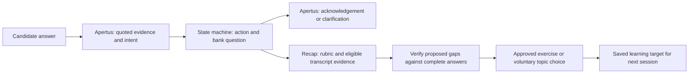

# AI-Powered Job Interview Coach

An Apertus-based interview practice app for teenagers preparing for their first job or apprenticeship. Built for HackApertus 2026, Track 2A — FHGR.

**Status:** Runnable Docker web prototype with a complete interview controller and multilingual final feedback. Development simulations cover all 28 organiser scenarios. Coaching quality has known limitations; the official benchmark and consumer-hardware VRAM validation remain outstanding.

## Features

- English, German, French and Italian interface and coaching instructions.
- A thirteen-question browser interview covering introduction, motivation, strengths/weaknesses, situational questions, candidate questions and closing, followed by feedback.
- Questions selected from the supplied FHGR bank, with at most one follow-up per eligible main question.
- Early recap, feedback across eleven criteria and conversation downloads.
- Hybrid practice in all four languages: visible evidence, voluntary topic selection, one learning exercise after choosing, answer revision and a saved learning target.
- A neutral answer placeholder with optional help. The current controller does not generate contextual hints; the interface uses its translated fallback guidance.
- Responsive desktop/mobile layouts and demo mode without model calls.
- Voice adapter hooks: ordered speech output and confirmed-transcript input; actual audio services are not included.

The scenario dropdown offers IT, retail, hospitality, technical and first-job practice labels. Currently all options use an apprenticeship question plan and a fictional apprenticeship posting; the first-job option does not yet have a dedicated non-apprenticeship flow.

## Quick start

Install and start Docker Desktop or a compatible Docker engine. From the repository root:

```sh
make -C track_2a web-demo
```

Open **http://localhost:8080**. Demo mode advances through bank questions and ends with fixed example feedback; it provides no personalised AI coaching. Stop with Ctrl+C.

For Apertus, create the ignored `track_2a/data/.env` file:

```dotenv
LLM_API_KEY=your-key
LLM_BASE_URL=https://your-provider.example/v1
LLM_NAME=swiss-ai/Apertus-v1.5-8B
```

Use the model identifier and API base URL accepted by your serving endpoint. Then run:

```sh
make -C track_2a web
```

`make run` is an alias for the web app. See the [implementation README](track_2a/README.md) for deployment and local Python instructions. The Docker image contains the application and public runtime resources; Apertus weights and model serving are separate.

## Architecture and visual overview



All four languages use the same default pipeline in `src/interview_controller.py`: Apertus analyses each answer and writes a contextual reaction; code supplies the next bank question. Recap, verification, optional practice and revision use the shared logic in `src/hybrid.py`, with task prompts and fixed interface text in the session language. English questions include a translated supplement to the organiser bank. Later fixed-hybrid and connected conversation policies remain German-only experiments and are not defaults.

Main questions keep bank wording; competency availability is tracked, but automatic skipping and mastery-based selection are deferred. Each task permits at most one correction. Code caps counted calls below five per accepted interview/practice answer across the session. Full recaps isolate criteria in small requests; early recaps use fewer groups to fit the budget. Proposed gaps receive a separate verification request. A learning call runs only after an explicit voluntary topic choice, using the selected question and original answer without rejected proposal text. Gap verification cannot automatically assign an exercise. Rejecting a gap withholds dependent or negative assessments while retaining explicitly independent, quote-backed positive assessments. Exact quotations do not guarantee correct interpretation or relevance.

For future voice support, responses expose language-tagged speech segments and turn IDs. Browser events support playback cancellation and recognised text as an editable answer draft. No microphone or audio playback is enabled; model responses arrive in full rather than streaming. See the [voice integration contract](track_2a/README.md#voice-integration-contract).

Sessions are owned and saved by the server. The browser keeps a display copy and sends a session ID, revision and answer. Refresh starts a new session; login and share links are not implemented. API credentials remain server-side. In AI mode, answers go to the configured model provider.

## Development and evaluation

Python 3.12 is the Docker runtime. No third-party Python packages or frontend build tools are required.

```sh
conda env create -f environment.yml
conda activate apertus-interview-coach
cd track_2a
make test
python src/web.py --provider demo
```

The current evaluation replays final recaps on the same 28 organiser conversations (20 German, five French and three Italian). English remains available in the practice interface for debugging and is excluded from the current review set. Candidate answers are generated by a separate simulator; its calls are excluded from coach accounting. Whole-interview guideline labels are drafts for human validation, not an official benchmark. Shared functionality does not establish equivalent coaching quality across languages.

Run `make -C track_2a review-demo` for the fictional review demonstration, or follow the [manual review guide](track_2a/src/review/README.md) to import completed sessions, label guidelines, cite evidence and save drafts. The tool makes no model calls; optional translation preparation is separate.

The challenge weights performance at 50%, consistency at 25% and innovation at 25%, with practicality as a required gate. Recorded call efficiency is below five calls per answer, but hosted inference does not establish operation below 32 GB VRAM. Grounding, candidate-question handling, repetition and follow-up selection remain weaknesses.

## Repository

| Path | Purpose |
| --- | --- |
| [track_2a/README.md](track_2a/README.md) | Setup, deployment and session behaviour |
| `track_2a/src/` | Web server, controller, model clients, prompts, interface and tests |
| `track_2a/data/interview/` | Public runtime questions, fictional postings, rubric and guidelines |
| `track_2a/Makefile` | Web launch and test commands |
| [Manual review guide](track_2a/src/review/README.md) | Portable review interface, imports, translations and draft labels |
| `environment.yml` | Optional Conda environment |

Credentials, sessions, experimental tooling, generated runs and manual-review labels remain local. Reusable review code and its documentation are published alongside the application.

## License

See [LICENSE](LICENSE). Bundled organiser resources retain their upstream attribution and usage conditions; see [data provenance](track_2a/data/interview/README.md).
