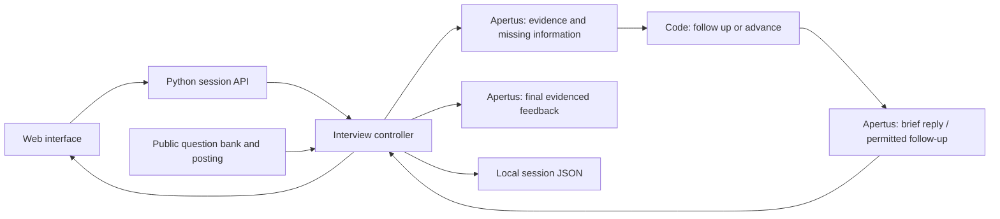

# Interview Coach — Implementation

See the [project overview](../README.md) for the audience, scope, and challenge requirements.

## Docker setup

Start Docker Desktop or a compatible Docker engine. From this directory:

```sh
make web-demo
```

Open **http://localhost:8080**. Stop with Ctrl+C. Demo mode uses fixed example feedback and makes no AI calls.

For personalised coaching, create `data/.env` locally:

```sh
mkdir -p data
```

Add your provider configuration to that file:

```dotenv
LLM_API_KEY=your-key
LLM_BASE_URL=https://your-provider.example/v1
LLM_NAME=your-apertus-model-id
```

Use the provider's actual API base URL, including its API prefix. The server appends `/chat/completions`. Use HTTPS for remote authenticated endpoints. The `.env` file is ignored by Git.

Launch the coach:

```sh
make web
```

`make run` also launches the web app. The launcher loads `data/.env`, builds the image, and binds the published port to loopback. It detects Docker Desktop's bundled CLI on macOS and reports when the engine is unavailable.

## Other launch options

Change the host port:

```sh
make web-demo WEB_PORT=8082
```

For development with an already-installed model served by Ollama on the host:

```sh
make web COACH_PROVIDER=ollama COACH_MODEL=llama3:8b
```

The container reaches host Ollama through `host.docker.internal:11434`. Set `DOCKER_OLLAMA_BASE_URL` to override it. This development model is not the final Apertus submission.

The legacy stateless API accepts a reviewed prompt profile supplied with `PROFILE=data/profiles/name.json`. Profiles are local JSON files and do not override the new session controller prompts; the application uses the small `prompt_profile.py` loader, without depending on the local human-review tool.

Without Docker, use Python 3.12 and run:

```sh
python src/web.py --provider demo
```

For direct Apertus use, export the provider variables in your shell first, then use `--provider apertus`. For direct Ollama use, use `--provider ollama --model llama3:8b`; its default endpoint is `http://127.0.0.1:11434`. No third-party Python packages are required.

## Architecture and session flow



The server selects a bank-question plan and owns stage, subtype, topic coverage and counters. For every interview answer, including introductions, an analysis request extracts at most three observations with exact candidate quotes, an answered/partial/unanswered status and missing information. Code validates quote presence, then permits one follow-up only for a partial/unanswered answer with a stated gap and remaining eligibility. A separate speaker request phrases a short, warm contextual reply. Strong self-doubt is routed to support; actual company-information requests are answered even outside the candidate-question stage. Evidence records preserve quotes, open gaps, clarifications and tentative conflicts for future recap work. Advancing always uses the exact next bank question. The same configured Apertus model handles analysis, speaking and final feedback; no judge runs in the live interview.

Current prompts are `src/prompts/session/analysis.<language>.txt`, `speaker.<language>.txt` and `feedback.<language>.txt` for German, French and Italian; English uses the unsuffixed files. `examples.<language>.json` supplies a small stage/action-selected set of demonstrations. Older `interviewer*` prompts are retained as the previous design and are no longer used by the controller. Analysis sees the actual question, stage/subtype, latest answer and dialogue. The speaker additionally receives the code action, validated analysis, public posting and next bank question. Final feedback still receives the whole actual transcript, eleven-criterion rubric and feedback guidelines. `guidance.<language>.json` localises those public rules; `instructions.json` supplies corrections and fixed responses. Simulator personas, annotations and scenario success criteria are excluded from coach input. Older `prompts/web/` are used only by the legacy stateless API.

## Data and privacy

Server-owned sessions, transcripts and request traces are persisted locally in ignored `data/sessions/`. The browser currently starts a fresh session on refresh; persisted sessions are not a login or share-link feature. Clear local session files when no longer needed. Answers are sent to the configured model provider. API keys remain server-side and model text is rendered as text, not HTML.

The bundled server is intended for local use. Public authenticated hosting needs additional deployment work. Public runtime resources are in `data/interview/`; experimental tools and generated runs remain Git-ignored.

## Tests and development results

From this directory, run:

```sh
make test
```

All 66 application tests pass. They cover progression bounds, conditional question selection, language-specific prompts, evidence validation, server-owned revisions/persistence and the retained legacy API. Model responses are mocked in these tests; passing tests does not establish coaching quality.

The preceding v8 warmth/memory experiment completed the same ten highlighted organiser scenarios with a separate Apertus candidate simulator: 135 answers and 290 coach calls, including retries and final feedback, averaging 2.15 calls per answer (highest session average: 2.54). All ten assistant reviews are drafts for validation. Some replies are warmer, but copied demonstration wording, unanswered company questions and missed self-doubt support remain serious problems. No formal follow-ups or memory clarification/conflict links were produced. The preceding v7 run covered all 28 scenarios (1.73 calls per answer). This is not a fixed-answer causal comparison. See [technical_report.md](technical_report.md) for details.

Simulation/evaluation tools, generated runs and manual-review data are deliberately Git-ignored. A fresh clone includes the application, public runtime resources and application tests, but not those local experiments. Commands for private experiment scripts are therefore not part of the submission deployment instructions.

## Session behaviour and limits

Browser sessions start through `/api/session/start`. Clients send a session ID, revision and answer to `/api/answer` or `/api/recap`. Code stores the question plan, current stage/subtype, covered topics, main-question/follow-up counts, transcript and request traces. It updates stage context as the interview progresses.

The browser plan has thirteen main questions, including interview closing, followed by feedback across all eleven FHGR criteria. Each eligible main question permits at most one follow-up; small talk, candidate questions and closing do not. Completing the plan triggers final feedback automatically. Recap ends early and asks the model to acknowledge unavailable evidence. An unsent answer can be included when requesting recap.

The displayed answer ceiling is a conservative bound of twice the plan length (26); eligible-question restrictions make the actual maximum smaller. `MAX_ANSWERS` and `--max-answers` belong to the retained stateless API and do not change the browser controller's plan. The controller currently returns no generated hint, so the interface uses its translated fallback guidance. The first-job scenario label currently selects an apprenticeship posting and the same question plan, rather than a separate first-job interview.

An interview answer normally makes two calls: analysis and speaker, each with at most one correction. Ordinary closing runs analysis then uses fixed thanks before final feedback; introductions now run analysis and speaker so self-doubt can receive support. Final feedback permits one correction. Code counts every attempted coach request, reserves two calls for feedback and enforces a session budget of `5 × accepted answers − 1`; retry attempts also consume it. Invalid analysis is recorded without invented evidence; invalid speaker output or insufficient budget advances using neutral bank wording. A validated distress quote permits a supportive fallback. Follow-ups cannot repeat a planned main question or an already-asked question. The policy applies to all four languages. Transport failures remain retryable errors, and failed final feedback is reported. No live judge is used.

The v8 warmth/memory experiment keeps the supplied question plans and the existing recap prompt/renderer unchanged. It does not yet shorten interviews or feed stored evidence into final assessments.

## Docker packaging and practicality

`src/run.sh` copies the versioned public resources from `data/interview/` into ignored `src/interview_data/` before building. The image bundles the Python runtime, application, static interface, prompts and these resources. It excludes credentials, experiments, simulation profiles, annotations and generated outputs. Session files persist in the host's ignored `data/sessions/` directory through a bind mount. Run `make web` or `make web-demo` to prepare the build context; a bare Docker build from a fresh clone lacks the staged resource directory.

The image is an application client; it does not install or serve Apertus weights. Hosted inference does not verify the under-32-GB VRAM requirement. A consumer-hardware Apertus deployment, quantisation/context settings and measured memory usage remain outstanding. The recorded hosted development run meets the call-efficiency threshold, but does not establish the complete practicality gate.

## Local manual review (not included in a fresh clone)

The developer's local portal runs on port 8081 and groups individual-answer v1/v2 and whole-interview v5/v6/v7/v8, plus six German hybrid v9 fixed-context comparisons. It preserves each version's labels separately, displays category summaries and draft/validated status, and links exact coach evidence to guideline notes. Originals are expanded by default, with collapsible AI-assisted English reading aids underneath. All four complete-interview versions have cached English transcript translations; originals remain authoritative.

The v7 version highlights ten purposively selected cases with stars; all 28 draft reviews remain accessible. This shortlist covers all three languages and six scenario formats, and is not an unbiased sample for estimating failure rates.

The portal and its data remain under ignored `src/experiments/` and `data/manual_review/`. The local `make review` target requires those files and is not a supported command for a clean submission checkout. The previous individual review servers have been replaced by this single portal.

## Voice integration contract

The application is text-only, with adapter hooks for future speech recognition (ASR) and text-to-speech (TTS). No microphone, audio upload, speech SDK, playback or model-token streaming is enabled. The existing text interface needs no voice adapter and makes the same coach calls.

Controlled session responses (`/api/session/start`, `/api/answer` and `/api/recap` with a session ID) include a `speech` field. The legacy stateless API does not. `src/voice.py` converts the opening or delivered reply into ordered sentence/paragraph chunks of at most 240 characters. This segmentation uses code rather than another LLM call. The original visible response is unchanged; speech chunks normalise boundary whitespace. The contract is:

```json
{
  "version": 1,
  "session_id": "server-generated-session-id",
  "turn_id": "server-generated-session-id:1:interview",
  "language": "de-CH",
  "kind": "interview",
  "segments": [
    {"id": "server-generated-session-id:1:interview:0", "text": "Danke."},
    {"id": "server-generated-session-id:1:interview:1", "text": "Erzähl uns etwas über dich."}
  ],
  "streaming": false
}
```

Language tags are `en-GB`, `de-CH`, `fr-CH` and `it-CH`. `kind` is `opening`, `interview` or `feedback`. These labels identify output turns, not separately classified acknowledgement/question segments. `turn_id` uses session ID, answer revision and kind, so early recap without another answer has a different ID from the preceding interview turn. Segment IDs allow a TTS adapter to deduplicate and play in array order. The envelope is produced after the complete model response has been validated; generation is not streamed. An adapter can synthesise and play short segments incrementally after receiving it. Future low-latency model streaming requires a separate transport/validation design.

The browser publishes these events on `window`:

| Event | Detail | Adapter responsibility |
| --- | --- | --- |
| `coach:output` | The `speech` envelope | Enqueue speech in order, track the session/turn IDs, ignore duplicate or stale output. |
| `coach:cancel` | `{session_id}` | Stop playback and cancel pending synthesis/recognition; discard late callbacks. Fired on restart, language/scenario reset, answer/recap submission and page exit. This does not cancel an in-flight coach request. |
| `coach:transcription` | `{session_id, language, final, text}` supplied by ASR | Send only a final transcript for the current session; `language` uses the UI code (`en`, `de`, `fr`, `it`). |

A future ASR adapter can populate the answer draft using:

```javascript
window.dispatchEvent(new CustomEvent('coach:transcription', {
  detail: {
    session_id: currentSessionId,
    language: 'de',
    final: true,
    text: 'Ich interessiere mich für Technik.'
  }
}));
```

The browser rejects interim, stale-session, wrong-language, empty and over-4,000-character transcripts, and transcripts arriving while a request is pending or the session is complete. It does not overwrite an existing draft or submit automatically. The user reviews/edits the recognised text and presses Send. Only that confirmed text reaches the coach through the existing answer API; audio, confidence, accent and inferred voice traits are not sent or assessed.

An audio adapter must obtain user permission before using the microphone or sending speech text to an additional service. It must register its listeners before session start, handle cancellation and choose a compatible voice for the language tag. The current server policy allows same-origin connections; using an external browser speech service needs an explicit deployment/privacy and content-security-policy decision. Voice adapters are not implemented or enabled by this change.

The v8 version contains the same ten validation scenarios, with separate draft labels and evidence records in the analysis fold. Start validation with S-23 (missed strong-self-doubt support), S-07 or S-10 (copied demonstrations/company questions), and S-27 (unresolved occupation conflict). Older samples and labels are preserved.


## German hybrid pipeline (v9)

German sessions now dispatch to `src/hybrid.py`; English/French/Italian use the preceding v8 pipeline described above. Normal German turns use analysis plus interviewer/fact-selection, while support can be supplied by code. Advance acknowledgements are limited to 22 words, cannot contain an added question and reject selected forms of unsupported skill praise. Only clarification actions can generate a question; advancing uses the exact next bank question. Plans have at most 15 main questions and one clarification per eligible question. Automatic competency-based question skipping is not implemented.

`hybrid_analysis.de.txt` extracts literal quotes, a specific gap, candidate requests and support needs. Quoted observations are not skill judgements. Code labels reported/hypothetical evidence and tracks unassessed/partial/evidence-available competencies; evidence availability is not mastery. A conservative German self-doubt pattern backs up model routing. Company requests use `hybrid_company.de.txt` to select explicit posting excerpts by fact ID, with unavailable parts acknowledged. This prevents free invented company rules, but selection can still be incomplete or irrelevant.

Recap uses `hybrid_evaluator.de.txt` in up to three small criterion groups, with public rubric anchors and question-scoped evidence IDs. Short early recaps use one group. Scores without eligible evidence are rejected; voice/body-language assessment is unavailable for text, and unassessed entries cannot contain free-form judgements. Literal evidence checks cannot establish semantic validity. Feedback renders the actual quoted passages and question IDs.

`hybrid_learning.de.txt` receives one code-selected lowest-scoring supported target, offering one concrete exercise, reflection and revision. Targets scored 3–4 are marked optional practice. Learner alignment is imperfect and needs validation. `/api/revise` uses `hybrid_revision.de.txt` to compare a revised answer against that target without replacing original scores. Interview and practice answers are separate counters; all attempted requests count against `5 × (interview answers + practice answers) − 1`.

The German interface offers experience (`first_interview`/`some_practice`) and difficulty (`easy`/`standard`/`challenging`). These are passed as context; effects are not benchmarked. The browser remembers a previous session ID locally and supplies it when starting another session for the same scenario. The server restores up to three saved exercises only for the same posting, exposing the latest learning target. This is a minimal practice history, not a progress score, login or transcript-resume feature. `/api/session/start` also accepts these fields directly; server-owned session data remains authoritative.

The six v9 review cases are independent frozen-context comparisons of S-07/S-12/S-23/S-24/S-25/S-26, reusing all 77 saved candidate answers. Each reply sees the original preceding v8 dialogue; changed clarification branches would be left unanswered rather than receiving an unrelated saved answer. No such branch was generated. Source questions in the portal are marked as context and are excluded from labelled output. The recap assesses the original candidate transcript. Recorded calls: 188 (2.44 per answer, max case average 2.77), including retries and evaluator/learning tasks. Five speaker fallbacks and one truncated evaluator group remain. Six assistant-authored reviews are drafts, with notes per guideline. They show improvement in support and evidence display but still flag unsupported interpretation in every case. They are not official or human-validated scores.

Docker now includes `hybrid.py`; the image must be rebuilt before deployment. Final consumer-hardware VRAM verification remains outstanding.

A recap after only greeting/arrival small talk uses a short deterministic acknowledgement: no scores, invented deficiency, learning task or revision target. This phase guard was added during live UI verification and does not affect the six substantive fixed-context comparisons.

## Actual question tracking

Candidate turns store the actual spoken question separately from the planned bank wording. Analysis and German recap question–answer pairs use actual wording; evidence includes it too. New coach turns store their question independently of the acknowledgement. Older sessions fall back to the saved preceding coach reply, with explicit provenance, and only use bank wording when history is unavailable. This fixes context handling, not generated-question purpose compliance. No additional model calls are introduced.
