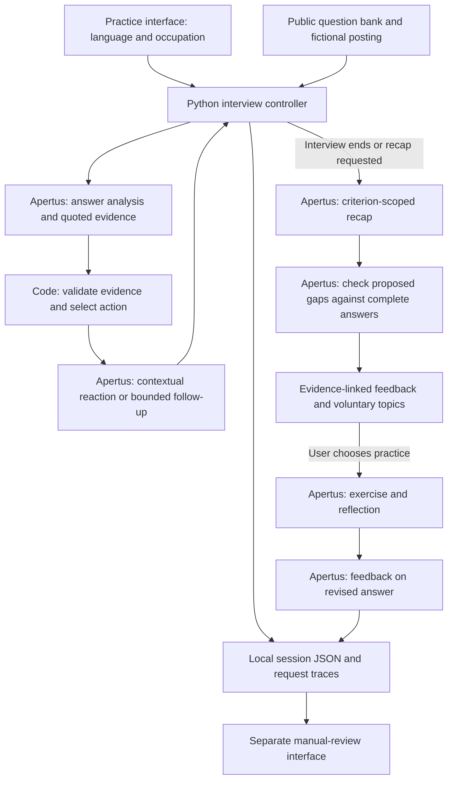

# Technical report — Interview Coach

- **Track:** Track 2A — FHGR interview coach
- **Event:** Online
- **Team:** Next Question — Alisa Smirnova
- **Demo:** Video URL to be added before submission (maximum two minutes).

## 1. Summary

Interview Coach helps teenagers practise for a first apprenticeship or job interview. A Python state machine controls interview progression, while Apertus analyses answers, produces conversational reactions and bounded follow-ups, and generates evidence-linked feedback. German, French, Italian and English use the same default pipeline with language-specific prompts. The most recent development evaluation regenerated recaps for 28 saved German/French/Italian interviews, covering 416 candidate answers. Reconstructed whole-session cost averaged 2.83 coach requests per answer, with a maximum session average of 3.50. These are descriptive runtime results, not validated coaching-quality scores. The application provides Docker deployment, a browser practice interface, optional answer revision and a separate manual-review tool; local model-serving memory requirements remain unverified.

## 2. Architecture

The application uses a dependency-free Python HTTP server and an HTML/CSS/JavaScript interface. The server owns session state; the browser submits a session ID, revision and answer. Apertus runs at a separately configured API endpoint. The application container includes public interview resources, prompts and browser assets, but no model weights or credentials.



`src/interview_controller.py` stores the stage, question subtype, covered topics, question/follow-up counts, actual spoken question, answers, evidence records and request accounting. The browser uses thirteen main questions, progressing through introduction, motivation, self-reflection, situational questions, candidate questions and closing. Code retains bank wording when advancing. Eligible questions permit at most one clarification; small talk, candidate questions and closing do not. The user can request an early recap. Covered topics indicate interview coverage, not demonstrated competence; automatic mastery-based selection is not implemented.

`src/hybrid.py` handles recap, proposal verification, voluntary practice and revision. Candidate excerpts are associated with relevant rubric criteria. Proposed gaps are checked against complete question–answer pairs, including later answers. Unsupported negative or dependent assessments are withheld; explicitly independent positive assessments may remain. The verifier cannot assign an exercise. Practice starts only after an explicit topic choice and receives the selected question, original answer and evidence without rejected proposal text. Revision assessment receives the assigned exercise and most recent accepted answer. Practice turns are saved in the transcript but excluded from original-interview evidence.

`src/web.py` atomically persists session JSON. Exact retries of the latest accepted operation replay its saved response without another model call, including after a server restart. Browser storage is optional. A fully failed recap preserves answers and permits budget-aware recap retries without rerunning the interview; exhausted budgets leave download and restart available. Partially available recaps mark affected criteria unavailable. Refresh starts a new session; there is no login or shared-session link. A server-wide lock serialises mutations, limiting concurrent use.

The interface exposes ordered, language-tagged speech segments and browser events for output, cancellation and confirmed transcription input. Recognised text becomes an editable draft requiring explicit submission. Audio capture, ASR, TTS and model streaming are not implemented.

## 3. Use of Apertus

- **Model:** Development evaluation used `swiss-ai/Apertus-v1.5-8B`. Deployment uses the model ID configured through `LLM_NAME`.
- **How it is used:** Inference for answer analysis, conversational delivery, recap evaluation, proposal verification, optional learning and answer revision. No fine-tuning, adapters or separate judge model run in the live application.
- **Where it runs:** A remote OpenAI-compatible chat-completions endpoint. Credentials and the endpoint are server-side environment configuration; they are not sent to the browser.

The opening is selected in code without a model request. A substantive answer normally uses an analysis request and a speaker request. Ordinary, adequately answered greetings and self-introductions in German, French and Italian use a fixed translated transition after analysis, avoiding a speaker request. Concerns, company questions and incomplete introductions retain model handling. English remains model-driven for debugging. The generic trial-day advancement demonstration is omitted from speaker prompts. Analysis receives actual question wording, stage/subtype, the answer, dialogue and prior evidence. Code checks exact quotes and selects advancement, clarification, company reply or supportive acknowledgement. The speaker receives the permitted action, posting context and next bank question. Language-specific instructions and small demonstrations guide output; validated model text still requires semantic review.

Recap uses criterion-scoped requests, with smaller groups when budget allows. Public rubric definitions, feedback guidelines, complete answers and eligible evidence IDs are supplied. A separate request verifies proposed gaps when proposals exist. Recap makes no automatic learning request. Explicit practice selection generates an exercise; subsequent revisions use the saved exercise and preceding accepted answer. Prompts are mapped in [src/prompts/session/README.md](src/prompts/session/README.md).

Tasks use JSON schemas, validation and at most one correction attempt. Every attempted request counts towards a session budget of fewer than five requests per accepted interview/practice answer; retries cannot reset accounting. Failed persistence rolls back dialogue changes while retaining spent-call accounting in memory and attempting to save it. Persistent disk failure followed by a crash can still lose that accounting. No local quantisation or model-serving stack is bundled, so hosted request efficiency does not establish compliance with the under-32-GB VRAM requirement.

## 4. Data

Runtime resources come from the [FHGR Hackapertus datasets](https://github.com/fhgr/Hackapertus/tree/main/datasets): interview questions, fictional apprenticeship postings, the eleven-criterion candidate rubric and constructive-feedback guidelines. Copies are stored in `data/interview/`, with source SHA-256 hashes in `manifest.json`. English question text includes a supplementary translation file where needed. Browser occupational choices currently use apprenticeship plans, including the first-job label.

Development evaluation used all 28 organiser scenarios: 20 German, five French and three Italian. Candidate answers were generated by a separate Apertus simulator using fictional profiles and actual interviewer questions. Candidate personas and scenario success criteria were withheld from the coach. Annotated answer pairs and good/bad feedback examples informed development review; reference annotations are not live coach inputs. The candidate rubric assesses interview answers; the separate feedback guidelines assess coach behaviour.

The organisers identify FHGR/Profolio didactic material, rubric and guidelines as FHGR property provided for challenge use. Synthetic records have the same stated conditions; occupation information originates from berufsberatung.ch/SDBB. These resources are not assumed to have an unrestricted redistribution licence. Upstream attribution and conditions are retained in [data/interview/README.md](data/interview/README.md).

Generated conversations, evaluation annotations, review labels and credentials remain outside the published runtime dataset. The evaluation described here uses fictional candidates, not recruited human participants, and measures no human learning outcomes. During real practice, answers are sent to the configured provider and saved on the local server; the interface asks users to avoid identifying details. Authentication, retention management and public multi-user deployment require further work.

## 5. Evaluation

Evaluation combines recorded request counts, completion checks and assistant-authored whole-interview reviews against the feedback guidelines. The same Apertus model generated simulated candidates and coach outputs, so simulation is not an independent quality assessment. No official performance score, calibrated LLM-as-judge score or consistency score is claimed. The available manual-review set contains 28 draft reviews requiring human validation.

The retained full-interview source cohort covers all 28 scenarios, including successful fresh retries of two initial failures. It contains 416 candidate answers. The latest recap evaluation reuses these exact interviewer turns and candidate answers and regenerates only the recaps using shared multilingual logic. It is not a new full-interview run or a controlled end-to-end comparison of the latest code.

| Setup | Metric | Result |
| --- | --- | ---: |
| Saved conversation cohort | Scenarios / candidate answers | 28 / 416 |
| Latest recap-only evaluation | New recap calls | 322 |
| Reused conversation traces | Previously recorded conversation calls | 856 |
| Reconstructed whole sessions | Total coach calls | 1,178 |
| Reconstructed whole sessions | Calls per answer / highest session average | 2.83 / 3.50 |
| Latest recap-only evaluation | Recaps returned / sessions with voluntary topics | 28 / 28 |
| Latest recap-only evaluation | Automatically assigned exercises | 0 |
| Latest recap-only evaluation | Unavailable criterion groups | 22 |
| Current code regression checks | Python tests / JavaScript checks passed | 159 / 11 |
| Independent baseline and official benchmark | Performance and consistency scores | Not measured |

Results show bounded model usage, end-to-end coverage of the supplied situations and explicit user control over practice. Reviews found generally courteous language and useful occupation-specific questions. Visible citations improve traceability, but do not establish that an assessment follows from its evidence.

The language breakdown shows uneven recap reliability: one unavailable criterion group in German, ten in French and eleven in Italian. There were 179 retained ratings across German interviews, 30 across French and 13 across Italian; these counts measure availability, not correctness or comparable performance. Repetitive reactions, unsupported company details, over-interpretation of answers and insufficient acknowledgement of self-doubt remain observed weaknesses.

Recorded comparison details and per-case source hashes are local under `data/runs/full-interviews-v17-optional-recap/evaluation/`. These results predate the latest session-recovery, practice-transcript and revision-context fixes. Those fixes have regression coverage but have not been evaluated in another model-driven full-interview run. Their passing tests must not be presented as demonstrated coaching-quality improvement.

## 6. Limitations

- Exact quote and schema checks establish structural validity, not factual grounding, relevance or fair assessment. The verifier uses the same model and can approve irrelevant gaps or reject useful ones.
- Conversational reactions can be mechanical, repetitive or abrupt. Company answers may add unsupported facts, and supportive responses may not adequately acknowledge strong self-doubt.
- Clarification was not exercised in the retained full-interview cohort. Implemented follow-up bounds do not demonstrate useful adaptation to incomplete answers.
- Recap requests can truncate or fail validation, particularly in French and Italian. Conservative withholding reduces misleading scores but can leave feedback incomplete. Voluntary exercises can remain generic.
- English is available for debugging and practice but excluded from the evaluation cohort. Dialect comprehension, repeated-run consistency and real-user learning benefits are unmeasured.
- Shared-model candidate simulation and development-selected scenarios limit external validity. Assistant-authored draft reviews are not independently validated labels.
- The Docker image runs the application client. Consumer-hardware model serving, quantised quality, VRAM, latency and endpoint acceptance under the challenge rules remain unverified.
- Experimental conversation policies remain in the source but are not the default submission behaviour. Production authentication, multi-user scaling, audio services and a progress dashboard are not implemented.

## 7. Reproducibility

The implementation reviewed for this report is commit `bfa79d8` (`Finalize multilingual coach and recoverable practice sessions`); the fixed-opening transitions and other pending application/documentation changes described here are not part of that code commit. The saved-conversation evaluation predates it and records its own source hashes. Generated traces and experimental runners are local and ignored by Git, so the published repository alone does not reproduce the historical evaluation cohort or its draft labels. Model sampling and candidate simulation were not controlled for a reproducible multi-seed comparison.

Install Docker Desktop or a compatible engine. From `track_2a`, configure the following in ignored `data/.env`, using the provider's actual API base URL and Apertus model ID:

```dotenv
LLM_API_KEY=your-key
LLM_BASE_URL=https://your-provider.example/v1
LLM_NAME=your-apertus-model-id
```

Run the application from the repository root:

```sh
make -C track_2a run
```

The launcher stages public runtime resources, builds the Python 3.12 image and binds the web interface to `http://localhost:8080`. It mounts local session storage and excludes secrets, generated results and experimental scripts from the image. `make -C track_2a web-demo` provides fixed example feedback without model calls; it is not an AI evaluation. Python requires no third-party application packages.

Run deterministic regression checks:

```sh
make -C track_2a test
# Optional Node.js is needed only for this browser-test harness:
node track_2a/src/tests/browser_session.test.js
```

Tests mock model outputs; they cover progression, evidence validation, request accounting, failed writes, lost-response recovery, recap retries, practice/revision persistence and review import. JavaScript checks cover denied browser storage and response recovery. Before submission, perform a clean-clone Docker smoke test: answer substantive questions, request a recap, select a voluntary exercise, revise twice, and confirm the downloaded and persisted transcripts include all practice turns. This final manual smoke test is pending. A prior Docker build succeeded, but the final clean-clone run must verify the committed submission state.

The manual-review tool can be tried without private evaluation files:

```sh
make -C track_2a review-demo
```

See [README.md](README.md) for full deployment, privacy, voice-adapter and review instructions. Hosted inference measurements provide no model-serving hardware or wall-clock latency benchmark.

## 8. Next steps

1. Ground every company reply and candidate assessment in relevant source facts, with explicit unknown handling and human-validated evaluation examples across German, French and Italian.
2. Improve attention to the candidate's answer, transitions and concise feedback; verify clarification and self-doubt handling in targeted real-user or independently reviewed sessions.
3. Validate voluntary exercise usefulness and answer revision, then assess repeatability, learning outcomes and a quantified consumer-hardware deployment. Add actual voice services only after the text pipeline and privacy controls are validated.

## License

Repository source code is provided under the Apache License 2.0, as declared in [LICENSE](../LICENSE). This report does not change the repository licence. Organiser resources retain their upstream attribution and challenge-use conditions; they are not relicensed by the application.

## References

- [HackApertus technical-report template](https://github.com/HackApertus/project-template/blob/main/track_2a/technical_report.md) — report structure.
- [FHGR Hackapertus datasets and attribution](https://github.com/fhgr/Hackapertus/tree/main/datasets) — public resources, synthetic scenarios and usage conditions.
- [Application documentation](README.md) and [prompt map](src/prompts/session/README.md) — deployment and task inputs.
- [Public resource manifest](data/interview/manifest.json) — bundled source-file hashes.
- Local evaluation evidence: `data/runs/full-interviews-v17-optional-recap/evaluation/comparison.json` and `README.md`; these files are not included in Git.
