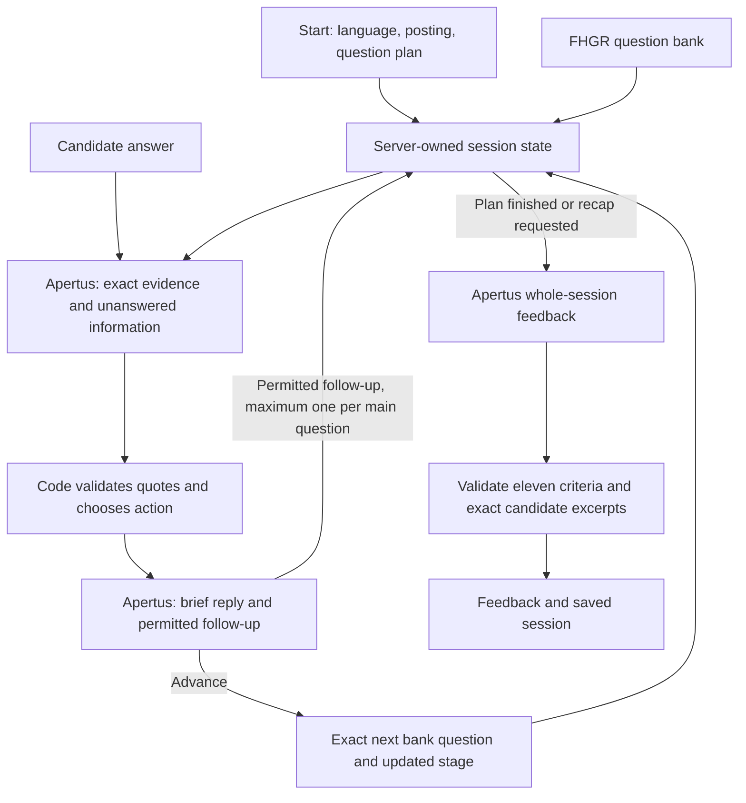

# Interview Coach — technical report

* **Track 2A** — `FHGR` 
* **Team:** `Next Question` -- `Alisa Smirnova`
* **Demo:** TBD

## Approach and architecture

German sessions now use the hybrid v9 implementation described at the end of this report; the following diagram describes the preceding v8 pipeline, retained for English/French/Italian. The application runs an apprenticeship practice interview from opening to closing, followed by coaching feedback. A deterministic Python controller owns progression; Apertus provides conversational transitions, company answers and optional follow-ups. This separates interview coverage and termination from generative decisions.

`src/interview_controller.py` stores current stage, question subtype, covered stage/subtopic pairs, main-question count, total/current follow-up count, answers, transcript, answer analyses, code turn decisions, completion state and request traces. Coverage means a topic was asked/answered, not that the answer demonstrated competence. Conditional bank questions are selected only when the supplied dossier establishes eligibility. The default browser plan contains thirteen main questions; organiser scenarios use their own ten-to-seventeen-question plans, including phone, trial and assessment formats. Recap can end early.

`src/web.py` provides session start, answer and recap APIs. A session ID and answer revision prevent clients from replacing server-owned dialogue or submitting stale answers. Atomic JSON replacement persists sessions locally. The current browser does not resume a persisted session after refresh. A server-wide lock serialises session mutations; this is acceptable for a local prototype but limits concurrent use.

## Earlier prompt construction (v8; retained for English/French/Italian)

Development inference used `swiss-ai/Apertus-v1.5-8B` through the configured CSCS endpoint. Credentials live in ignored `data/.env`; never bundle them in the image.

1. Opening: code selects the first bank question; no LLM request.
2. Answer analysis: `prompts/session/analysis.<language>.txt` (unsuffixed for English), actual asked question, stage/subtype, latest answer and dialogue. Every accepted answer, including introduction and closing, is analysed. The model returns at most three quoted observations, answered/partial/unanswered status, missing information, exact company-request/self-doubt quotes and prior evidence-record IDs for clarification or tentative conflict. Stage-selected fictional demonstrations are appended. Quotes must occur exactly in the latest candidate answer. Code normalises the missing-information field to empty for answered replies.
3. Decision: code permits a follow-up only for a stated gap in a partial/unanswered answer, with another planned question and no previous follow-up for the current main question. The model does not control stage progression. Strong self-doubt has a support action; company requests have an answer action. Evidence records preserve source quotes, original gaps and tentative links without labelling dishonesty. Follow-ups cannot repeat any planned main question or an already-asked question. Exact quotes do not prove a gap or inferred intention is meaningful.
4. Speaking: `speaker.<language>.txt`, validated analysis, permitted action, public posting and actual dialogue. Normal acknowledgement is bounded to 35 words, follow-up question to 35, support to 60 and company answer to 80. Action-selected fictional demonstrations and prior evidence records are included. Advancing uses exact bank wording in all four languages. Introductions now use analysis and speaking so they can receive contextual acknowledgement or support. Ordinary closing uses analysis and fixed thanks.
5. Final recap: unchanged `feedback.<language>.txt`, public eleven-criterion rubric, guidelines and actual whole transcript. Candidate excerpts constrain evidence; unsupported scores are withheld. Quotes remain internal rather than included in delivered feedback, a known K1 limitation.

Each task permits one correction. All attempted coach requests count against `5 × accepted answers − 1`, reserving two calls for feedback during interview tasks. Invalid analysis is bypassed; invalid speaker output or insufficient budget advances with a neutral bank fallback. Transport failures remain retryable errors; failed feedback is reported rather than fabricated. No judge or candidate simulator runs in the live app.

Public resources are in `data/interview/`, copied from the organiser repository with provenance/hashes. No reference annotations are used by the controller. Hidden candidate simulation personas and scenario evaluation hooks are provided only to experimental simulation code, never to the interviewer. Docker bundles the runtime and public resources; generated results and experimental tooling are excluded.

## Earlier full-session development evaluation (v5)

All 28 organiser scenarios were completed with a separate Apertus candidate simulator: 20 German, 5 French and 3 Italian interviews. The simulator uses fictional profiles/personas and answers the interviewer; its calls are test overhead. Scenario READMEs and interview-flow documentation informed format-specific plans and conditional selection.

The earlier aggregate is `data/runs/full-interviews-v5/`. Successful checkpoints from preceding development versions were reused after fixing simulator roles, topic drift and output-validation failures. Exact prompts, raw model responses and errors are preserved per case; this aggregate is a development smoke run across revisions, not a clean fixed-version benchmark or a baseline comparison.

| Measure | Result |
| --- | ---: |
| Completed scenarios | 28/28 |
| Candidate answers | 416 |
| Coach requests, including recorded retries and feedback | 488 |
| Coach requests per answer | 1.17 |
| Highest session average | 1.44 |
| Candidate-simulator requests | 416 |
| Main questions per interview | 10–17 |
| Adaptive follow-ups requested | 0 |

One final-run checkpoint records a deterministic bank fallback after truncated interviewer output. Earlier attempt errors remain in request traces. Completion does not imply useful adaptation: zero follow-ups is a significant failure despite implemented bounds.

The coding assistant inspected complete coach conversations and authored draft labels against all 26 rules in the current guideline file (including the multilingual addition S4). No LLM judge produced these labels. They are provisional and require Alisa's validation. Review units are whole sessions, with “Not applicable” for absent triggers and “Not sure” for ambiguous interpretation. The review distinguishes candidate-visible feedback from internal evidence fields.

| Draft finding | Sessions |
| --- | ---: |
| K3: at least one unsupported/invented assessment or detail | 28/28 |
| K1: some delivered feedback lacks a concrete reference | 28/28 |
| S4: substantial feedback in the wrong language | 19/28 |
| A1: final closing omits explicit practice framing | 17/28 |

These historical counts are assistant-authored draft findings, not validated performance scores. Some evidence interpretations need correction: P-08 explicitly permits third-year learners to lead a residential group for two weeks. The earlier contrary criticism must not be treated as a verified violation. Tone remains respectful across all reviewed sessions. Other recurring problems include unanswered candidate questions, repeated acknowledgements, unnecessary improvement advice and employer-role promises. A self-doubt scenario needs validation of whether the generic acknowledgement is sufficient; the candidate already proposes speaking with a teacher/career adviser.

## Limitations and next priorities

The submission is a functional prototype with known coaching-quality limitations. Constrained JSON and literal quote checks cannot prevent false inferences. Company answers invent schedules, communication tools and even contact details; these should be generated from selected facts with explicit unknown handling. The earlier run often switched final output to English; localised instructions eliminated substantial switches in the latest development run. Internal quotes are currently omitted from the delivered recap; the UI must display evidence alongside concise feedback. Follow-up selection needs targeted examples and separate checks on genuinely weak answers.

The simulator sometimes produces unrealistically polished answers, dialect despite a Standard German instruction, or reverses roles (S-28). Assessment/group-task scenarios are dialogue approximations, not execution of the real tasks. English interviews, human learning outcomes, repeatability and the organisers' hidden LLM-as-judge benchmark are unmeasured.

The recorded coach-call average is below the fewer-than-five threshold in this hosted run. Local consumer-grade deployment below 32 GB VRAM has not been measured; the Docker image is the application client, not an included model-serving stack. Quantised Apertus serving and memory/context measurements remain required before claiming that gate.

## Reproduction and review

See `README.md` for Docker and environment setup. `make run` builds and starts the web application. Public deployment resources remain in Git; local experimental tools live under ignored `src/experiments/` and generated runs under ignored `data/runs/`.

The public checkout supports `make web-demo`, configured Apertus `make web`, and `make test` from `track_2a`. Experimental scenario runners and review tools are intentionally excluded from Git, so the reported development runs cannot be reproduced using only a fresh submission checkout. The supplied organiser data and local scripts were used during development; no local-path experiment commands are required for deployment.

Validation: 36 application tests pass, including progression bounds, conditional questions, hidden-persona exclusion, exact evidence rejection and early recap. These use mocked model responses. The initial image built and started successfully. After subsequent controller/API refinements, a rebuild encountered a Docker Hub HTTP 500; those refinements were smoke-tested in the existing image using read-only source mounts. A fresh end-to-end build of the final submitted image remains to be verified. Documentation updates do not constitute a new Docker verification. Local VRAM feasibility is outstanding.

## Instruction localisation and fresh development run (v6)

German, French and Italian sessions now use translated interviewer/feedback instructions, controller task reminders, correction requests, rubric meanings/score anchors and all feedback guidelines. Original English prompts are preserved for English sessions. Technical schema keys and IDs remain unchanged. The controller includes only the selected-language question text; original company facts and candidate excerpts are not translated. French/Italian coaching-guidance translations require review.

This change adds no decomposition calls and leaves progression, retry limits and scoring rules unchanged. A fresh run in `data/runs/full-interviews-v6-localized/` completed all 28 scenarios with `swiss-ai/Apertus-v1.5-8B`. Coach instructions/controller stayed fixed; prompt snapshots, hashes, raw outputs and request traces are retained. SHA-256 checks confirm old v5 results and review artifacts were not changed.

| Latest-run measure | Result |
| --- | ---: |
| Completed scenarios | 28/28 |
| Candidate answers | 417 |
| Coach calls, including corrections and final feedback | 471 |
| Coach calls per answer / highest session average | 1.13 / 1.20 |
| Simulator calls, including two failed attempts | 419 |
| Adaptive follow-ups | 1, repeating an already answered question |
| Deterministic role-play-ending fallbacks | 25 |
| Final scores withheld for missing evidence | 1 |

Manual assistant reviews cover each complete interview against the same 26 guideline rules, with notes and exact coach quotations or explanations for missing elements. All 28 are saved as drafts for user validation. Draft counts: K1 28 violations; K3 20 violations, 7 uncertain, 1 meets; E3 6 violations; K2 4 violations; S3 4 violations; A1 3 violations; S4 no violations. Tone remains respectful. Original transcripts are shown alongside company facts and separately identified internal evidence; cached AI-assisted English translations are now available for all turns in both full-interview versions. Translations are reading aids and have not been independently verified.

Language consistency and practice framing look better than v5. Grounding, response to candidate questions, repetition and adaptation remain serious problems. For example, S-20 invents eye contact from text, S-25 penalises difficult-question performance without asking a difficult question, and S-07 unnecessarily penalises dialect. Internal exact quotes are still omitted from candidate-visible feedback. Most individual sentences are short; long repetitive paragraphs are a distinct readability problem.

This is a development simulation, not a fixed-input causal benchmark or a validated performance score. Candidate answers vary from v5, which itself contains mixed revisions. In S-03, two truncated simulator responses required resuming only that scenario with a longer simulator token budget and a shorter-answer instruction; coach prompts were unchanged. Hosted inference still does not verify local VRAM feasibility.

## Current manual-review workflow

One local portal on port 8081 now contains individual-answer v1/v2 and complete-interview v5/v6/v7; the earlier separate review servers were stopped. Each version keeps its own labels. Original text is expanded by default and English reading aids are collapsed below it; either can be toggled independently. Saved version-wide category counts and per-example findings distinguish violations, uncertainty and validation status. Exact coach evidence is highlighted in the original text and links to the relevant guideline, with a return link to the passage.

All three full-interview versions have cached translations (888 v5 turns, 890 v6 turns and 896 v7 turns), matched to the source sample and individual turn hashes. Translations are AI-assisted and not independently verified; source text remains authoritative. The ten original individual-answer labels were validated by Alisa; stage-aware individual-answer and complete-interview labels remain drafts. This review portal is local experimental tooling, not included in the submission image or required to run the coach.

## Submission scope and remaining validation

The versioned submission includes the controller, multilingual prompts, public runtime resources, web interface, model client, Docker packaging, deployment instructions and tests. This report and the project README contain a visual architecture overview. Generated transcripts, review labels, translation caches, credentials and experimental scripts remain local.

The image depends on a separately served Apertus model. Official benchmark scoring, repeatability/consistency measurements, human learning outcomes and local VRAM measurement are not available. The latest 2.15 coach calls per answer is a recorded development-run average. A code budget now limits counted coach requests across a session; it does not establish VRAM feasibility or latency. The work is submitted as a prototype with these limitations disclosed.

## Voice readiness

`src/voice.py` is a dependency-free boundary between delivered coach text and a future speech adapter. Controlled APIs attach a versioned speech envelope containing session/turn IDs, a BCP-47 language tag and ordered chunks of at most 240 characters. Segmentation does not change prompts, progression, candidate-visible text or coach-call counts. Early recap gets a different turn ID even when the answer revision is unchanged. Docker includes this module.

The browser emits output and cancellation events; cancellation covers reset, language/scenario changes, submission and page exit. A future ASR adapter supplies a final transcript tagged with the active session and UI language. The browser accepts it only as an editable draft, without overwriting typed input or automatically submitting. Interim/stale transcripts and unsupported lengths are ignored. The coach continues to receive confirmed text, with no acoustic/prosody judgments.

This is an integration contract, not implemented speech functionality or demonstrated real-time latency. There is no microphone capture, audio transport, synthesis/playback, model-token streaming or new speech dependency. TTS can consume ordered segments after response validation; streaming model output would need further validation/transport work. Adapter consent, voice availability and network policy remain deployment concerns. See the implementation README for event names and payload examples.

Validation includes chunk preservation/bounds for multilingual and unbroken text, distinct recap/playback identities, and controlled-API speech metadata. All 36 application tests pass. The final Docker image still needs a fresh build and end-to-end verification after this runtime change.

## Evidence analysis and code-controlled decisions (v7)

The decomposition separates understanding an answer from phrasing the next turn. Each task has fewer responsibilities; quoted observations are stored for inspection, while code owns the follow-up decision. The final-feedback task was deliberately left unchanged to isolate this first pipeline change. The simulator was instructed to keep answers under 150 words, with a 1,800-token output budget. This still often produces polished answers rather than the weak profile behaviour.

All 28 scenarios were run and reviewed, preserving v5/v6 outputs. Ten cases are highlighted for user validation rather than requiring review of all 28: S-04, S-07, S-09, S-10, S-12, S-23, S-24, S-25, S-26 and S-27. This purposive shortlist covers all three languages and all six formats, including observed failures and useful contrasts. It is not an unbiased statistical sample.

| v7 recorded measure | Result |
| --- | ---: |
| Completed scenarios | 28/28 |
| Candidate answers / coach calls | 420 / 728 |
| Coach calls per answer / highest session average | 1.73 / 1.94 |
| Analysis / speaker / feedback attempts | 337 / 362 / 29 |
| Candidate-simulator attempts | 421 |
| Follow-ups | 4 |
| Analysis tasks safely bypassed / final scores withheld | 5 / 4 |

Results and fixed prompt/controller hashes are under ignored `data/runs/full-interviews-v7-decomposed-final/`. S-28 required a simulator-only truncation retry with a 3,200-token budget; its report records that override. Coach settings were unchanged. English, human outcomes and local VRAM were not measured.

All 28 reviews were assistant-authored drafts against the 26 guideline rules, with notes for every rule, exact original coach evidence where available, and explanations for absent elements. Draft violations: K1 28, K3 13, E3 9, K2 8, T2 3, S1 1 and L3 1. K3 remains uncertain in 15 cases; uncertainty is not counted as a violation. Tone has no draft T1/T3 violations, and S3 has no short-sentence violations. These are subjective draft judgements, not validated performance scores.

The live turns are shorter and avoid most unnecessary competence praise. Final recaps still omit their internal evidence, repeat generic exercises and sometimes invent or contradict findings. Candidates' company questions are frequently skipped. All four follow-ups are problematic: S-09/S-23 ask the next main question, which is then repeated; S-24/S-25 ask the candidate for company information instead of answering. In S-09 the analysis says no clarification is needed yet labels the answer unanswered, which incorrectly triggers the follow-up. S-27 repeats the same acknowledgement while failing to clarify conflicting occupations. S-23 does not support strong self-doubt when first expressed.

The request gate is met in this hosted run, but the decomposition alone has not solved coaching quality. Different generated candidate answers and simulator settings prevent a causal comparison with v6. The next targeted changes should fix company-answer routing, prevent follow-ups that duplicate future bank questions, and make final feedback consume and display a reviewed evidence record with one prioritised exercise. A fresh Docker build and under-32-GB serving measurement remain outstanding. The local portal includes original/English collapsible transcripts, internal analysis traces, all 28 drafts and ten starred validation recommendations.

## Warm contextual replies and evidence memory (v8)

This experiment adds short localised demonstrations, requires contextual acknowledgement on advance, and records exact candidate evidence throughout the interview. Analysis can link an open gap to later clarification or flag a potential contradiction. Code validates quotes and eligible IDs, preserves previous evidence, and prevents formal follow-ups duplicating bank questions. Company requests use an exact latest-answer quote rather than a boolean; strong self-doubt also requires a quoted trigger. These checks establish traceability, not correct semantic interpretation. The final recap prompt, inputs and renderer remain unchanged; evidence records are reserved for subsequent recap work.

The same ten purposively highlighted v7 scenarios were rerun, keeping their supplied question plans. Candidate answers were generated anew; this is a development comparison, not a paired causal benchmark. Organiser-inspired examples overlap development scenarios and are not held-out evaluation data. The superseded first v8 attempt remains separate and is excluded from validation. Corrected results and prompt/controller hashes are in ignored `data/runs/full-interviews-v8-warm-memory-final/`; S-04 and S-27 required checkpoint retries after HTTP 500 errors.

| v8 recorded measure | Result |
| --- | ---: |
| Completed scenarios | 10/10 |
| Candidate answers / coach calls | 135 / 290 |
| Coach calls per answer / highest session average | 2.15 / 2.54 |
| Analysis / speaker / feedback attempts | 137 / 143 / 10 |
| Formal follow-ups / speaker fallbacks | 0 / 5 |
| Evidence records / open gaps | 135 / 1 |
| Clarification links / conflict links / support actions | 0 / 0 / 0 |

All ten whole-interview reviews have 26 rule notes and draft status for Alisa's validation. Draft violations: K1 10, K2 7, K3 7, S1 1 and L3 1 (26 rule violations, not a performance score). Missing/unobservable behaviours use explained not-applicable labels; uncertain findings are not counted as violations. Some live acknowledgements are more contextual, but the model often copies demonstration wording: trial-day bridges appear before a placement is mentioned, and unrelated company questions receive the CV example. It can put extra or duplicate questions inside acknowledgement text despite zero formal follow-ups. S-23 repeatedly leaves the support trigger empty despite explicit strong self-doubt; S-27 creates no conflict links despite alternating occupations. Stored quotes have not yet translated into reliable adaptation. Final recaps retain their previous grounding and specificity problems.

These results do not establish a quality improvement. Prioritise user validation of S-23, S-07/S-10 and S-27 before revising demonstration format or trigger detection. Interview shortening and evidence-based recap construction remain future work. The local v8 portal includes original text, supplementary English translations, analysis/evidence traces and separate draft labels. All 43 application tests pass; local VRAM and a fresh final Docker build remain unverified.

## German hybrid architecture and fixed-context comparison (v9)

`src/hybrid.py` separates analysis, controller action, conversational delivery, source-fact selection, evaluation and learning. The current change is limited to German. Profile context includes profession, language, experience and difficulty; the state machine stores stage/subtype, question and follow-up counts, source evidence and competency availability. Main questions retain bank wording and fixed plans; mastery-based skipping is deferred. Available evidence is not demonstrated competence. The pipeline uses the configured Apertus 1.5 8B endpoint for all LLM roles, not separate model weights.

The controller prioritises explicit strong self-doubt and company-information requests over normal progression. Conservative German text patterns back up model intent extraction, without diagnosing the person. Support is offered once with a real trusted-person/career-counselling suggestion; subsequent explicit disclosures receive a shorter acknowledgement. Speaker acknowledgements cannot add questions, selected skill-praise formulas are rejected, and unsupported employer promises are neutralised. Company answers render selected original posting excerpts rather than free-form company claims; irrelevant or missing fact selection remains possible.

Final evaluation normally uses three compact groups of rubric criteria. Evidence IDs are constrained to answers associated with those criteria, with the original question and full answer available for interpretation. The evaluator does not see reference annotations. Unsupported/non-observable criteria remain unassessed; code suppresses free-form assessment text on null scores. Scores and quotes are stored, while the delivered recap displays explanations, question IDs and quoted passages. The learning role proposes one exercise/reflection for a code-selected supported target; high-scoring targets are optional practice. Target alignment is not guaranteed. A revision API/UI preserves initial scores and records another practice answer. Saved targets are carried into another session for the same posting; cross-session progress scoring and a history dashboard are not implemented.

| Fixed-context v9 measure | Result |
| --- | ---: |
| German cases / saved candidate answers | 6 / 77 |
| Coach calls / average / highest case average | 188 / 2.44 / 2.77 |
| Analysis / speaker / company attempts | 80 / 67 / 15 |
| Evaluator / learning attempts | 19 / 7 |
| Advance / company / support actions | 59 / 15 / 3 |
| Clarification branches | 0 |
| Speaker fallbacks / unavailable evaluator groups | 5 / 1 |

Each reply restores the EXACT preceding v8 conversation, question and candidate answer. This isolates response changes from candidate-simulator variation but does not test a coherent new full interview. A changed clarification would not be continued with an unrelated saved answer. Final assessment uses the original candidate transcript. Six review cases display explicitly marked frozen source questions, independent generated replies and the new recap. Context-only questions are excluded from labelled output. No new candidate-simulator calls are used. Six assistant-authored reviews remain drafts against all 26 rules; K3 is flagged in all six. K1 is now uncertain in all six rather than a clear violation, because citations are visible but several do not substantiate the complete interpretation. Support in S-23 is judged to meet L3. These are provisional findings, not validated benchmark scores.

Some acknowledgement wording is more contextual and obvious skill praise is reduced; many replies still repeat 'Danke für die Erklärung'. S-07 company answers now include relevant actual apprenticeship facts. Other requests remain incomplete, especially application documents in S-24/S-25. S-26's personal fit-checking can be misrouted as a company-information request. Evaluators still infer research from questions and sometimes judge only greeting excerpts while ignoring the substantive answer. A valid quotation can support the wrong conclusion. S-26's truncated group is transparently unavailable rather than assigned invented scores. Its remaining assessment and S-23's learning task still require careful validation. Some German abbreviations and ordinal dates are split too early when extracting excerpts; the excerpts remain literal but incomplete.

Raw model generations and hashes remain under ignored `data/runs/hybrid-v9-fixed-german-final-v2/`. Delivered outputs are separately preserved under `data/runs/hybrid-v9-fixed-german-delivered/`, recording a zero-call deterministic postprocessing step: punctuation, unsupported-employer-promise removal and canonical unassessed explanations. The current runtime applies those same delivery guards. Earlier development attempts remain separate and excluded from validation; all v8 sources and labels are preserved. Supplementary English reading aids remain AI-assisted and source-hash matched.

All 59 application tests pass, including support routing, repeated-support handling, extra-question rejection, source-fact validation, hypothetical evidence, criterion eligibility, visible citations, unassessed-text guards, revision accounting and plan bounds. Docker packaging includes the new runtime module; fresh final image verification and local VRAM measurement remain outstanding. Recorded request efficiency satisfies the call threshold for this hosted comparison. Follow-up adaptation, learning-target relevance and consistency still need validation before claiming a stronger coach.

Live UI verification exposed a remaining small-talk-only grading failure: the evaluator demanded deeper arrival detail despite a sufficient route answer. A deterministic phase guard now returns a short unassessed recap without a learning/revision target when only small talk has occurred. This guard was added after the six-case comparison and does not apply to any of those substantive transcripts.

## Actual question context correction

The current controller preserves actual question wording, including clarifications, in transcript records. Analysis and the existing grouped German evaluator receive that wording rather than reconstructed bank questions. Planned stage/criterion metadata remains separate. Old transcripts recover preceding coach replies with provenance. Regression tests cover actual analysis/evidence/recap context, old-session recovery, serialization and legacy-language analysis. The grouped evaluator, learner and prompt policies are unchanged.

## Persistence accounting correction

Successful inference followed by failed persistence no longer refunds model-call costs. Conversation state remains unaccepted, while costs/traces are retained and rollback accounting is persisted on a best-effort basis. Repeated disk failure retains accounting in memory; durable restart recovery requires a successful write. Regression tests cover repeated failures, recovered rollback accounting, successful transitions and failed revision saves.
